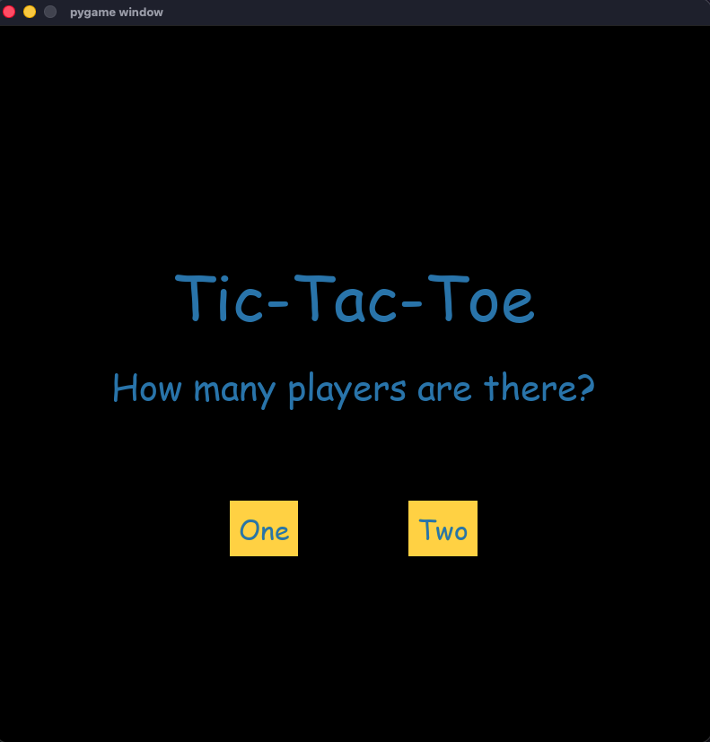
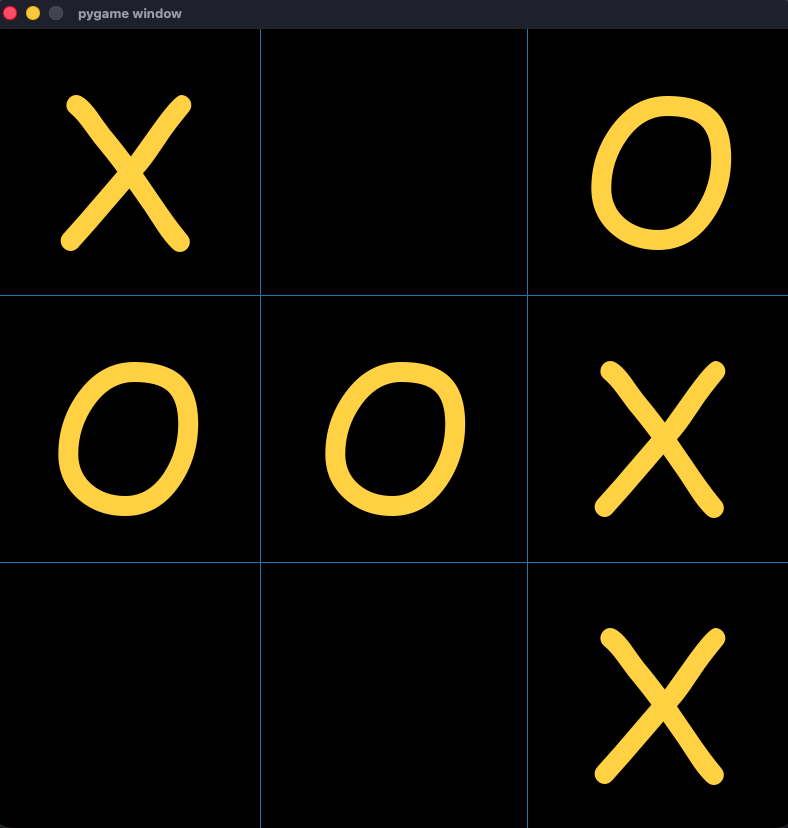
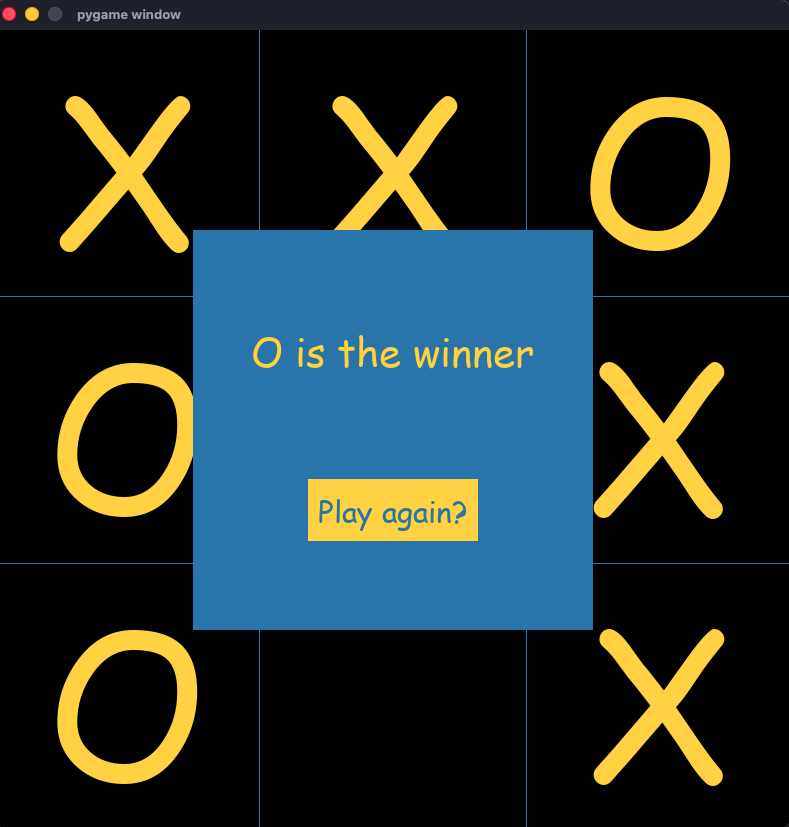

# Tic-Tac-Toe

Tic-tac-toe in Python + Pygame. Single or multiplayer.



## Features

- 1 or 2 players
- Pick X or O when playing the AI
- AI uses minimax with alpha-beta pruning, so it plays perfectly
- 'Play again' button at the end so you don't have to relaunch
- UCLA blue and gold







## Running It

Needs Python 3.10+ and pygame-ce.

```
python3 -m venv venv
source venv/bin/activate
pip install pygame-ce
python3 ttt.py
```

## How the AI Works

On its turn, the AI tries every open square and runs minimax on the rest of the game. It assumes you play perfectly too, scores each move +1 (AI wins), 0 (tie), or -1 (AI loses), and picks the best one. Alpha-beta pruning skips branches that can't change the result, making it faster.

## History

Started as a terminal version, then moved it to Pygame.
